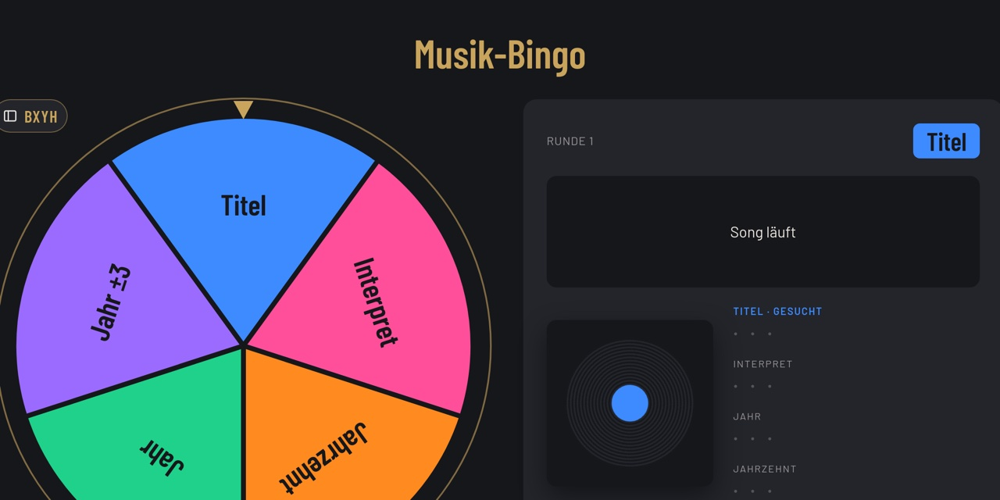
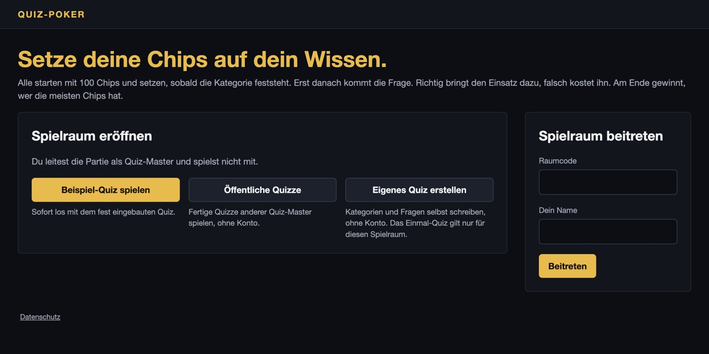
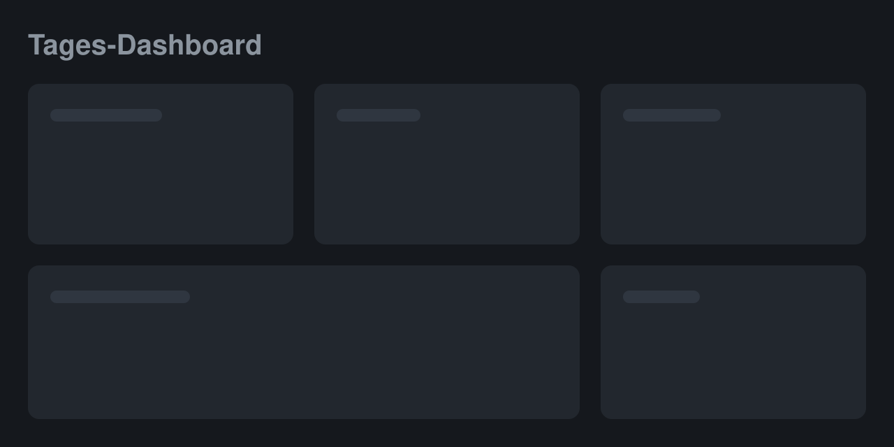

# Matzee3007

Coding mit Vibe

         

**Projekte**

<table>
  <tr>
    <td></td>
    <td>
      <b><a href="https://github.com/Matzee3007/musik-app">Musik-Bingo</a></b> 
      Musik-Bingo mit Spotify, in Echtzeit und mit Tests. 
          
      <a href="https://github.com/Matzee3007/musik-app">Code</a> · <a href="https://musik-bingo.vercel.app">Live</a>
    </td>
  </tr>
  <tr>
    <td></td>
    <td>
      <b><a href="https://github.com/Matzee3007/quiz-poker">Quiz-Poker</a></b> 
      Online-Quiz mit Pokerchips, in Echtzeit über WebSockets. 
         
      <a href="https://github.com/Matzee3007/quiz-poker">Code</a> · <a href="https://quiz-poker.quiz-poker.workers.dev">Live</a>
    </td>
  </tr>
  <tr>
    <td></td>
    <td>
      <b><a href="https://github.com/Matzee3007/tages-dashboard">Tages-Dashboard</a></b> 
      Persönliches Live-Dashboard mit KI-News, Sport und Schritten, als PWA und Mac-App. 
          
      <a href="https://github.com/Matzee3007/tages-dashboard">Code</a>
    </td>
  </tr>
</table>

Demnächst (tba): Sport-Fantasy, Backend mit Python, FastAPI und Postgres · Football Sim 27, Football-Simulation
